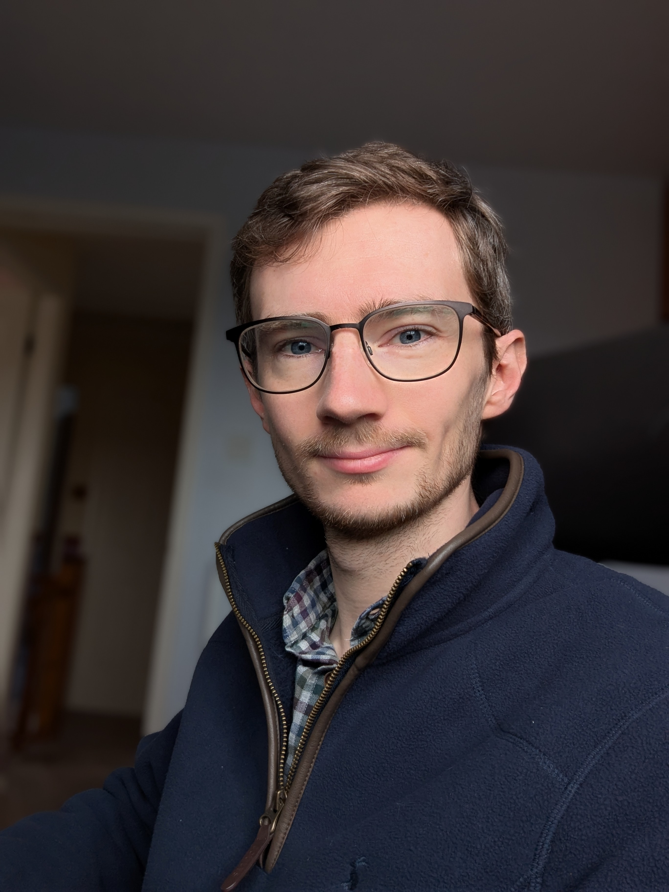

{::nomarkdown}

{:/}

Dr **George D. Watson-Hyde** MPhys (Hons) PhD (Ebor.)

I'm the Lead Machine Learning Scientist
at [Aptamer Group PLC](http://aptamergroup.com/),
where I'm developing AI models for in silico aptamer discovery.
This means building a new team from the ground up,
including setting the roadmap,
leading on AI strategy,
and establishing infrastructure and model architecture.
I have a PhD in the biophysics of DNA–protein binding,
the molecular basis of aptamer–target recognition,
and have since spent over five years
building and deploying
machine learning and statistical systems
in established organisations looking to make better use of their data.

I specialise in:
- Establishing new data and ML capability from scratch by building teams, processes, and technical stacks
- Leading large, interdisciplinary technical projects using machine learning, statistics, and scientific computing to solve difficult scientific problems
- Designing robust, interpretable machine learning models and tooling, as well as the MLOps to deploy them reliably
- Translating between wet-lab science, machine learning, and senior leadership to accelerate scientific discovery and turn it into commercial value

**Skills:**
Machine learning in Python and R
&bull;
Computational biology &amp; biophysics
&bull;
Deep learning
&bull;
Technical leadership

**Contact:**
<i class="ph ph-envelope"></i>
[hello@georgewatson.me](mailto:hello@georgewatson.me)
&bull;
<i class="ph-fill ph-linkedin-logo"></i>
[LinkedIn](https://www.linkedin.com/in/georgewatsonhyde/)

## Employment

* **Aptamer Group PLC**
  (2026--)\\
  Lead Machine Learning Scientist
  * As the first hire in the new machine learning (ML) team,
    I'm establishing the company's first ML function from the ground up,
    owning the strategy and reporting directly to senior leaders and the board.
    This includes defining the multi-year roadmap
    from data audit to generative design in production,
    as well as the hiring and investment needed to deliver it.
  * We're building an end-to-end discovery pipeline covering
    affinity prediction,
    epitope identification,
    and generative sequence design,
    integrated with wet-lab validation in a closed experimental feedback loop.
  * As well as line managing and mentoring,
    I have also designed and established tooling and ways of working for the team,
    including data and code versioning,
    experiment tracking,
    a model registry,
    and CI/CD.
* **Department for Work and Pensions**
  (2022--2026)\\
  Senior Data Scientist (2024--2026)\\
  Data Scientist (TDA, 2023--2024)\\
  Associate Data Scientist (2022--2024)
  * Developed and applied new data science &amp; machine learning techniques,
    including a novel Bayesian matching algorithm
    and custom deep-learning models to understand messy event data
  * Managed other data scientists
    and offered support for career development
  * Enhanced capability across the Department
    by leading popular data science learning & development sessions
  {:.compact-list}
* **Department for Environment, Food and Rural Affairs**
  (2021--2022)\\
  Statistical Officer
  * Led on production of high-profile government publications
  * Developed reproducible analytical pipelines in R
    to speed up production of statistical reports and reduce error
  {:.compact-list}
* **University of York**
  (2017--2021)\\
  Research Assistant in Molecular Dynamics Simulations (2021)\\
  Postgraduate Research Assistant in Biophysics (2017--2021)\\
  *Graduate Teaching Assistant (casual work, 2018--2020)*
  * Performed research into DNA--protein interactions
    using molecular dynamics simulations
  * Applied machine learning
    to extract information from large scientific datasets
  * Taught molecular simulation and scientific programming
    to undergraduate students via interactive workshop sessions
  {:.compact-list}

## Education

* **PhD Physics**\\
  University of York &bull; 2017--2021\\
  **Thesis:**
  ["Atomistic simulation of interactions between DNA and integration host
  factor"](https://etheses.whiterose.ac.uk/28874/)\\
  **Supervisors:** Agnes Noy, Mark Leake
* **MPhys (Hons) Theoretical Physics**
  (with first-class honours)\\
  University of York &bull; 2013--2017\\
  **Dissertation:**
  "Probing DNA intercalation through targeted molecular dynamics simulation of
  ellipticine and anthracene-derived ligands"\\
  **Dissertation supervisor:** Robert Greenall

## Publications

* <u>Watson&nbsp;G&nbsp;D</u>,
  Chan&nbsp;E&nbsp;W,
  Leake&nbsp;M&nbsp;C,
  Noy&nbsp;A
  2022\\
  "Structural interplay between DNA-shape protein recognition and supercoiling:
  the case of IHF"\\
  *Computational and Structural Biotechnology Journal*
  **20**
  5264--74\\
  [doi:10.1016/j.csbj.2022.09.020](https://doi.org/10.1016/j.csbj.2022.09.020)
* <u>Watson&nbsp;G</u>,
  Velasco-Berrelleza V,
  Noy A
  2022\\
  "Atomistic Molecular Dynamics Simulations of DNA in Complex 3D Arrangements
  for Comparison with Lower Resolution Structural Experiments"\\
  in
  Leake M C (ed.)\\
  Chromosome Architecture,
  *Methods in Molecular Biology*
  **2476**
  95--109\\
  [doi:10.1007/978-1-0716-2221-6_8](https://doi.org/10.1007/978-1-0716-2221-6_8)
* Yoshua&nbsp;S&nbsp;B&dagger;,
  <u>Watson&nbsp;G&nbsp;D</u>&dagger;,
  Howard&nbsp;J&nbsp;A&nbsp;L,
  Velasco-Berrelleza&nbsp;V,
  Leake&nbsp;M&nbsp;C,
  Noy&nbsp;A
  2021\\
  "Integration host factor bends and bridges DNA in a multiplicity of binding
  modes with varying specificity"\\
  *Nucleic&nbsp;Acids&nbsp;Research*
  **49**
  8684--98\\
  [doi:10.1093/nar/gkab641](https://doi.org/10.1093/nar/gkab641)
* <u>Watson&nbsp;G&nbsp;D</u>
  2021
  ["Atomistic simulation of interactions between DNA and integration host
  factor"](https://etheses.whiterose.ac.uk/28874/)
  (PhD thesis)
  University of York
  [uk.bl.ethos.832618](https://ethos.bl.uk/OrderDetails.do?uin=uk.bl.ethos.832618)

Key to symbols:
* &dagger; These authors contributed equally to this work.

## Talks &amp; Posters

### Talks
{:.no_toc}

* **Biological Physics Seminar Series**\\
  *University of York &bull; 22 May 2020*\\
  "Simulating the shape of DNA"
* **Physics Postgraduate Conference 2018**\\
  *University of York &bull; 21 September 2018*\\
  "Molecular dynamics simulation of supercoiled DNA minicircles"\\
  **Winner: Best Talk**{:.label}

### Poster Presentations
{:.no_toc}

* **6th Molecular Microbiology Meeting**
  &bull;
  *Newcastle University &bull; 17--18 June 2019*
  (<i class="ph ph-file-pdf"></i>
  [PDF](/dl/2019-04-08_poster.pdf))
* **[The Physics of Microorganisms
  II](https://www.iopconferences.org/iop/frontend/reg/thome.csp?pageID=785982)**
  &bull;
  *Institute of Physics &bull; 8 April 2019*
  (<i class="ph ph-file-pdf"></i>
  [PDF](/dl/2019-04-08_poster.pdf) &bull;
  [Blog]())
* **[PoLNET2 ECR Summer School: New Approaches to Biomolecular Structure,
  Dynamics and
  Function](http://www.physicsoflife.org.uk/summer-school-new-approaches-to-biomolecular-function-structure-and-dynamics.html)**
  &bull;
  *Durham University &bull; 16--20 July 2018*
  (<i class="ph ph-file-pdf"></i>
  [PDF](/dl/2018-06-28_poster.pdf))

## Teaching &amp; Outreach

### Teaching
{:.no_toc}

* **Advanced Computational Laboratory** (practical demonstration)\\
  *University of York &bull; 2018--2019*
  * Supervised, guided, and assisted students developing various programs for
    physical simulation, in a variety of languages including Fortran,
    during third-year computational laboratory
  * Led an experiment in single-particle plasma simulation,
    which included delivering a short introductory lecture
  * **Shortlisted: GTA of the Year**{:.label .label-meta}
  {:.compact-list}
* **Molecular Simulation** (practical demonstration)\\
  *University of York &bull; 2018--2020*
  * Provided support and assistance to third-year students
    during molecular dynamics workshop sessions

### Outreach
{:.no_toc}

* **York Festival of Ideas Fringe Family Fun Afternoon**\\
  *University of York &bull; June 2019*\\
  "DNA Detectives"
  * Hosted interactive DNA bracelets and DNA origami activities
    for children aged 5--11,
    explaining the structure and function of DNA appropriately
* **[York Researchers' Night
  (YorNight)](https://www.york.ac.uk/news-and-events/events/yornight/2018/)**
  \\
  *University of York &bull; November 2018*\\
  "Meet Your Molecules in VR"
  * Performed interactive virtual reality demonstrations of biological molecules
    and 3D visualisation techniques in biophysics
    for members of the public of various ages and backgrounds
    at a well attended event

## Professional Development

* **[Deep Learning
  Specialization](https://coursera.org/share/f0abdfebc5e6e8f3f0909bda99e92cfc)**
  &bull;
  *DeepLearning.AI (Coursera)* &bull; 2023
* **[Machine Learning
  Specialization](https://coursera.org/share/faae5738a01974fddcdc08a392c616e1)**
  &bull;
  *DeepLearning.AI &amp; Stanford University (Coursera)* &bull; 2023
* **[Certified Professional Data
  Scientist](https://www.datacamp.com/certificate/DS0012246607119)**
  &bull;
  *DataCamp* &bull; 2022 (expired 2024)
* **[Machine Learning](https://www.coursera.org/verify/P3P4AWNL7FAJ)**
  &bull;
  *Stanford University (Coursera)* &bull; 2021
* **[Introduction to Machine
  Learning](https://www.coursera.org/verify/GLFW96MPMD8L)**
  &bull;
  *Duke University (Coursera)* &bull; 2021
* **[Managing Big Data with
  MySQL](https://www.coursera.org/verify/X3HCUK387VT7)**
  &bull;
  *Duke University (Coursera)* &bull; 2021

## Memberships &amp; Awards

<!--
### Memberships
{:.no_toc}

  

* **Professional Member**, BCS, The Chartered Institute for IT (MBCS)
-->

### Awards
{:.no_toc}

* **Best Talk**,
  Physics Postgraduate Conference 2018\\
  *University of York &bull; 21 September 2018*\\
  (Prize sponsored by the Institute of Physics)
* Shortlisted:
  **Graduate Teaching Assistant of the Year**,
  Physics Awards 2019
  &bull;
  *University of York &bull; 1 May 2019*
* Shortlisted:
  **Postgraduate Makes a Difference**,
  Physics Awards 2019
  &bull;
  *University of York &bull; 1 May 2019*

## Other interests

When I'm not working,
you'll probably find me at my local parkrun,
reading,
practising my Greek,
or exploring a nature reserve.
My biggest weakness is YouTube videos of people playing *Cities: Skylines*.

* **Languages:**
  Greek/ελληνικά [el] (est. B1)
* **Running PBs:**
  5k:&nbsp;[20:52](https://www.strava.com/activities/17469282513)
  &bull;
  10k:&nbsp;[45:37](https://www.strava.com/activities/17985258023)
  &bull;
  Half&nbsp;marathon:&nbsp;[1:47:39](https://www.strava.com/activities/13962037817)
  &bull;
  Marathon:&nbsp;[3:43:40](https://www.strava.com/activities/20634821308)

Please feel free to get in touch
if you'd like any more information about anything in this CV.

*[AI]: artificial intelligence
*[BCS]: The Chartered Institute for IT (formerly British Computer Society)
*[BPSI]: Biological Physical Sciences Institute
*[CCPBioSim]: Collaborative Computational Project for Biomolecular Simulation
*[CV]: la: curriculum vitae (en: course of life)
*[Dr]: Doctor
*[DNA]: deoxyribonucleic acid
*[Ebor.]: la: Eboracum (en: York)
*[ECR]: early-career researcher
*[ed.]: editor
*[est.]: estimated
*[exp.]: expires
*[GTA]: Graduate Teaching Assistant
*[IHF]: integration host factor
*[MBCS]: Member of BCS, The Chartered Institute for IT (originally British Computer Society)
*[MInstP]: Member of the Institute of Physics
*[ML]: machine learning
*[MPhys (Hons)]: Master of Physics (with honours)
*[PBs]: personal bests
*[PLC]: Public Limited Company
*[PhD]: la: Philosophiae Doctor (en: Doctor of Philosophy)
*[PoLNET2]: Physics of Life Network, phase 2
*[TDA]: temporary duties allowance
*[VR]: virtual reality